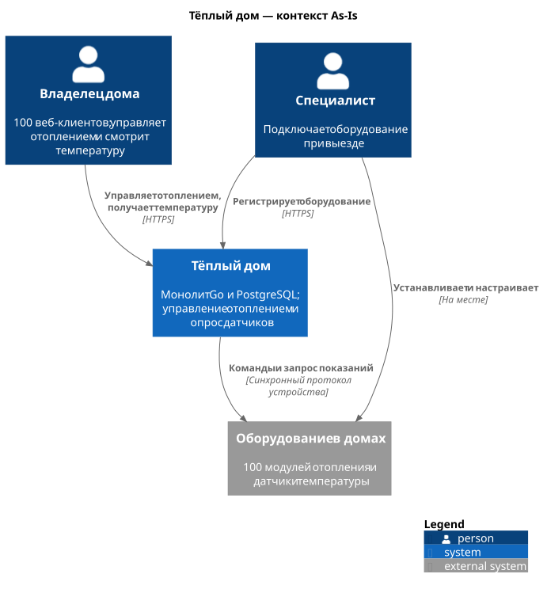
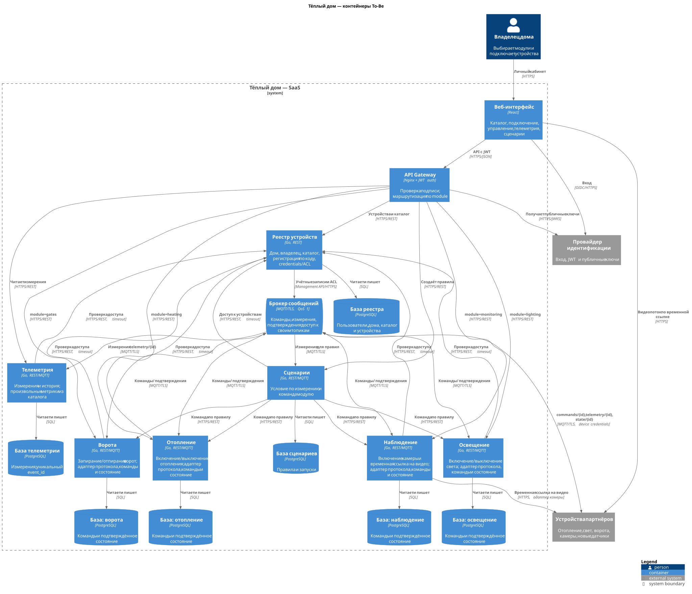
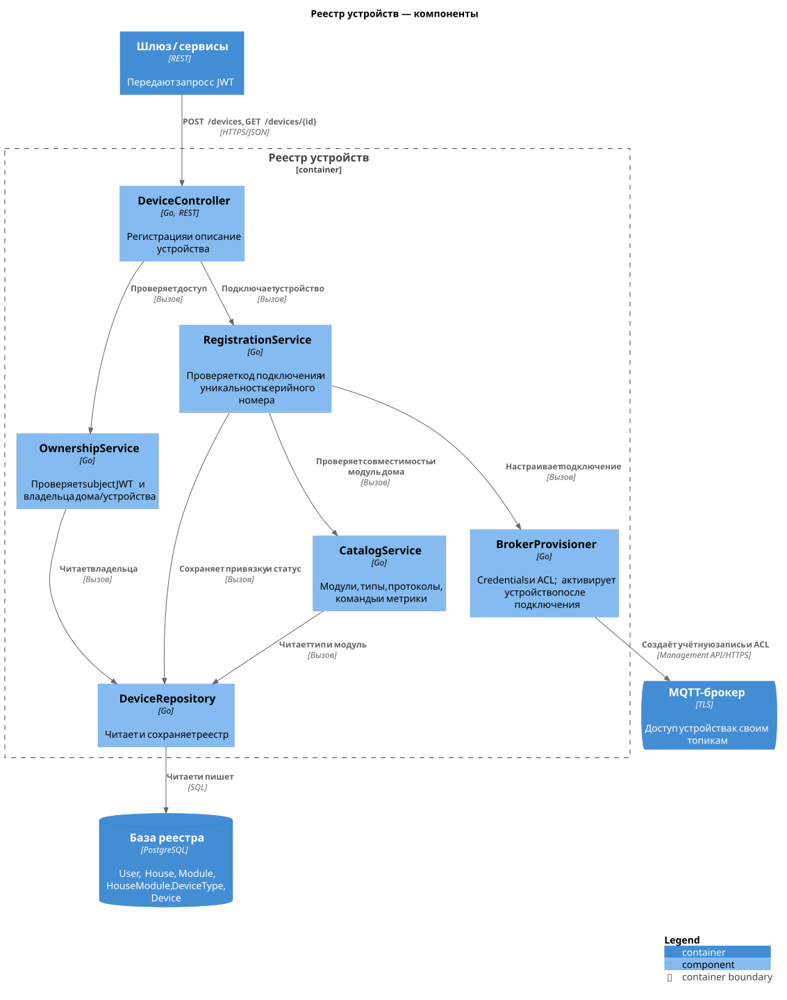
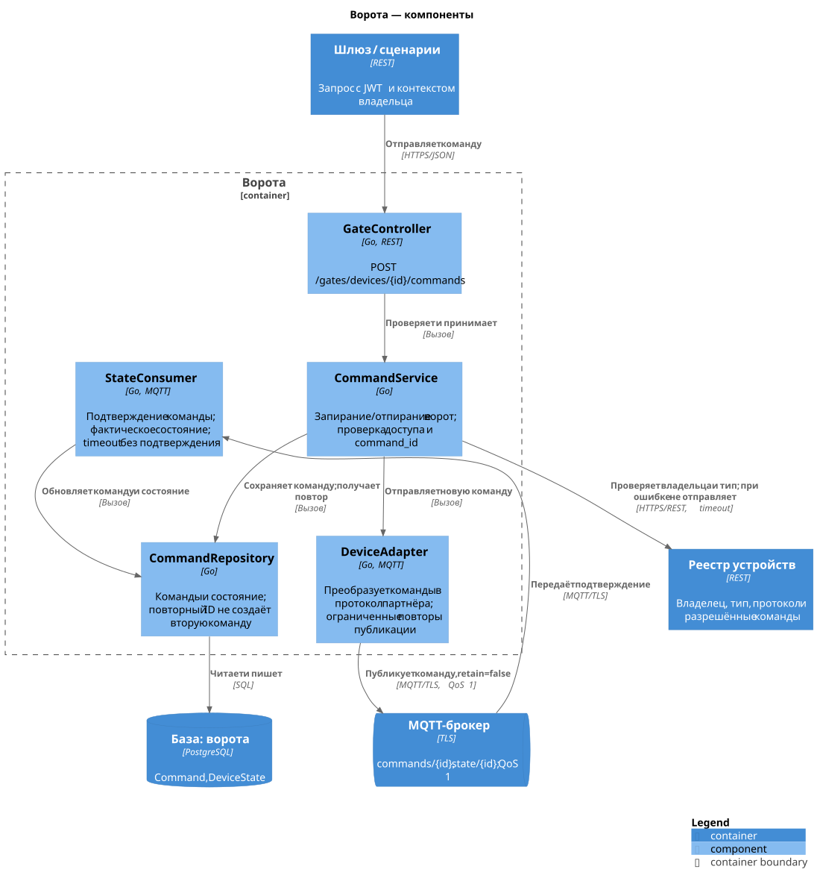
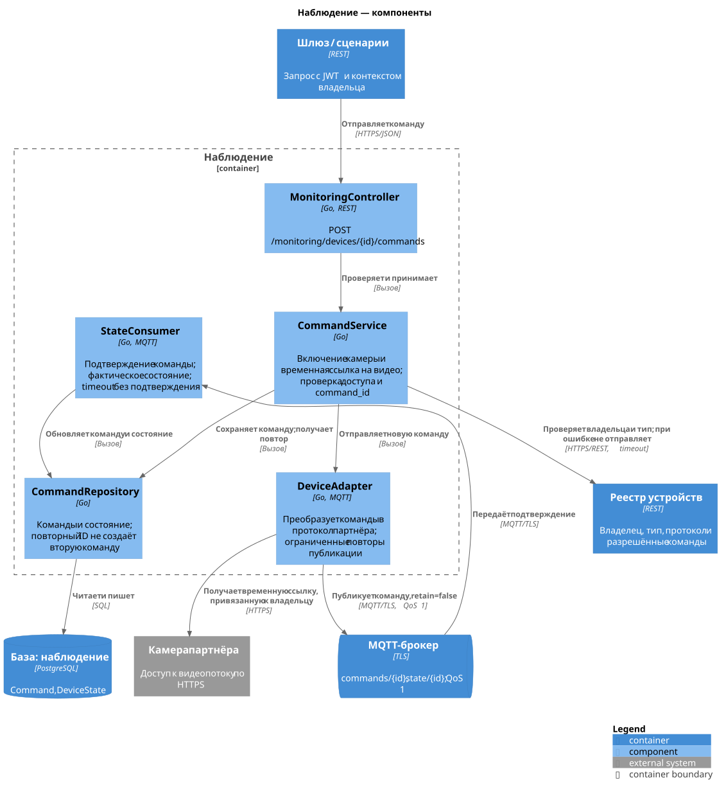
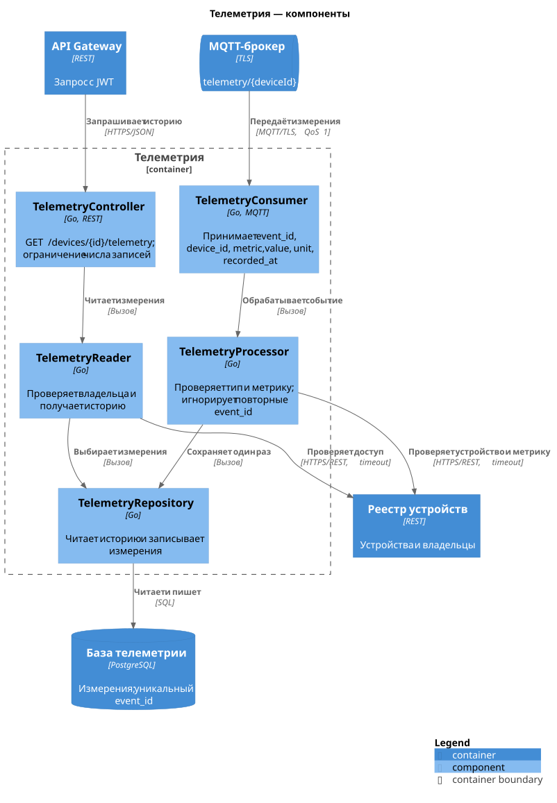
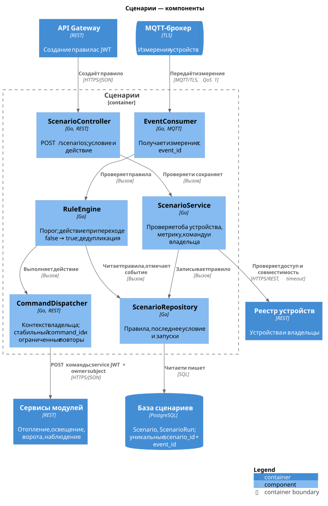
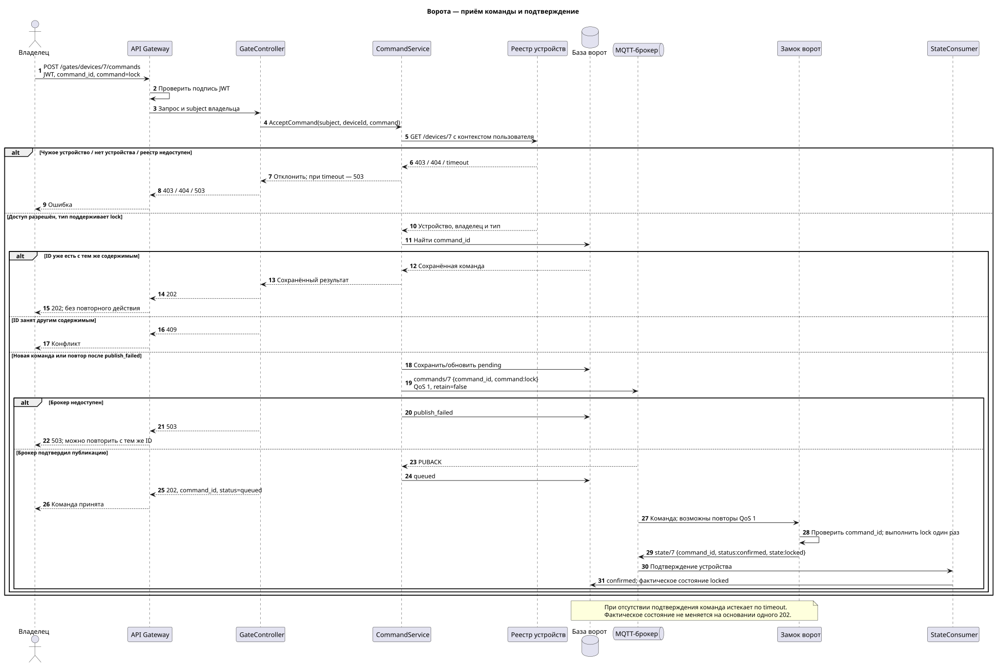
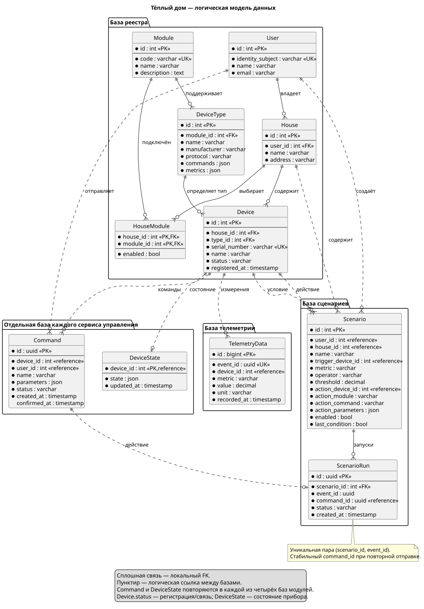

# Project_template

# Задание 1. Анализ и планирование

### 1. Описание функциональности монолитного приложения

**Управление отоплением:**

- Пользователь удалённо включает и выключает отопление своего дома.
- Сервер отправляет команды подключённому модулю отопления.
- Подключение оборудования выполняет выездной специалист.

**Мониторинг температуры:**

- Сервер запрашивает текущую температуру у датчика.
- Пользователь видит показания в веб-интерфейсе.
- Самостоятельное подключение датчиков не предусмотрено.

### 2. Анализ архитектуры монолитного приложения

Приложение написано на Go, данные хранятся в PostgreSQL. Обработка HTTP-запросов, бизнес-логика и доступ к данным объединены в одном приложении. Взаимодействие с устройствами синхронное: сервер инициирует запрос и ждёт ответ. Очередей сообщений нет. Сейчас подключены 100 веб-клиентов и 100 модулей отопления.

В предоставленном примере есть обработчики датчиков, модели, слой доступа к PostgreSQL и HTTP-клиент сервиса температуры. Это разделение внутри одного приложения. Пример реализует работу с датчиками; управление отоплением описано в условиях кейса.

### 3. Определение доменов и границы контекстов

| Контекст | As-Is | To-Be и граница ответственности |
| --- | --- | --- |
| Устройства | Оборудование подключает специалист | Реестр пользователей, домов, модулей и типов; самостоятельная регистрация и проверка владельца |
| Отопление | Включение и выключение отопления | Отдельный сервис команд и состояния отопительных устройств |
| Телеметрия | Синхронный запрос температуры | Приём измерений и просмотр истории разных показателей |
| Освещение | Отсутствует | Отдельный сервис включения и выключения света |
| Ворота | Отсутствует | Отдельный сервис запирания и отпирания ворот |
| Наблюдение | Отсутствует | Отдельный сервис управления камерами и доступа к видеопотоку |
| Сценарии | Отсутствует | Правила пользователя: условие по телеметрии и команда выбранному модулю |

Реестр хранит описание устройства и его принадлежность дому. Сервисы модулей хранят собственные команды и фактическое состояние. Телеметрия хранит измерения, сценарии — правила. У каждого сервиса своя база; чужие данные он получает через API. Вход пользователей делегируется внешнему провайдеру идентификации.

Каталог модулей позволяет выбирать готовые комплекты. В типе устройства указываются производитель, протокол, команды и метрики. Новый датчик можно добавить в каталог и подключить через адаптер поддерживаемого протокола. Новый вид управления потребует адаптера или отдельного сервиса. Для команды из пяти разработчиков на этапе MVP остаётся один веб-интерфейс.

### 4. Проблемы монолитного решения

- Медленный или недоступный датчик задерживает получение показаний из-за синхронного обращения.
- Получение телеметрии и управление отоплением нельзя независимо масштабировать.
- Изменение одной функции требует выпуска всего приложения. В текущем варианте из условия развёртывание останавливает приложение.
- Подключение каждого дома зависит от выезда специалиста, что затрудняет расширение на несколько регионов.
- Общая модель и база затрудняют добавление новых типов устройств и независимое развитие модулей.

Для существующих 100 клиентов монолит прост в поддержке. Разделение требуется для новых функций и самообслуживания.

План перехода:

1. Зафиксировать текущие сценарии и API, добавить проверки управления отоплением и получения температуры.
2. Выделить реестр, перенести пользователей, дома и устройства; включить подключение по коду из комплекта. Проверить владельца дома и поддержку протокола.
3. Выделить отопление и телеметрию. Старые устройства временно обслуживать через адаптер синхронного протокола, новые — через MQTT. По одному дому переключать маршруты. Для каждого набора данных назначить одного владельца записи.
4. Добавить освещение, ворота и наблюдение с отдельными базами и адаптерами. Проверить комплекты партнёров и работу после потери связи.
5. Подключить сценарии, провести пилот в одном посёлке и проверить нагрузку. Обучить поддержку и продажи, затем расширять подключение по регионам.
6. После сверки данных и проверки новых сценариев отключить старые маршруты и вывести монолит из эксплуатации. До этого сохранять возможность вернуть дом на старый маршрут без одновременной записи в обе системы.

### 5. Визуализация контекста системы — диаграмма C4



[Исходник](diagrams/context/as-is.puml)

# Задание 2. Проектирование микросервисной архитектуры

**Диаграмма контейнеров (Containers)**



[Исходник](diagrams/container/to-be.puml)

**Диаграмма компонентов (Components)**



[Исходник](diagrams/component/devices.puml)


[Исходник](diagrams/component/heating.puml)


[Исходник](diagrams/component/lighting.puml)



[Исходник](diagrams/component/gates.puml)



[Исходник](diagrams/component/monitoring.puml)



[Исходник](diagrams/component/telemetry.puml)



[Исходник](diagrams/component/scenarios.puml)

**Диаграмма кода (Code)**



[Исходник](diagrams/code/gate-command.puml)

# Задание 3. Разработка ER-диаграммы



[Исходник](diagrams/er/model.puml)

Сплошные связи находятся внутри базы сервиса. Пунктирные связи между базами обозначают логические ссылки по ID, без межбазовых внешних ключей. Проверка владельца выполняется через реестр.

# Задание 4. Создание и документирование API

### 1. Тип API

Для запросов между сервисами и веб-интерфейсом используется REST API с JSON через HTTPS. Так удобно получить описание устройства, зарегистрировать устройство, создать сценарий и принять команду. Ответ `202` означает принятие команды для доставки; фактическое состояние меняется после подтверждения устройства.

Устройства передают телеметрию и подтверждения через MQTT с TLS. Это позволяет принимать данные без постоянного опроса. Команды отправляются с QoS 1 и уникальным `command_id`; повторная доставка не должна повторять действие. Видеопоток передаётся по HTTPS по временной ссылке, отдельно от MQTT.

### 2. Документация API

[OpenAPI: пять эндпоинтов](api/openapi.yaml). Файл можно открыть в [Swagger Editor](https://editor.swagger.io/) через File → Import file.

| Метод и путь | Ответственный сервис |
| --- | --- |
| `POST /devices` | Реестр устройств |
| `GET /devices/{deviceId}` | Реестр устройств |
| `POST /{module}/devices/{deviceId}/commands` | Отопление, освещение, ворота или наблюдение; шлюз выбирает сервис по `module` |
| `GET /devices/{deviceId}/telemetry` | Телеметрия |
| `POST /scenarios` | Сценарии |

Контракты описывают проектируемую To-Be систему. Запускаемый пример из задания 5 использует API монолита из шаблона.

# Задание 5. Работа с docker и docker-compose

В [apps](apps/README.md) находятся монолит, PostgreSQL и `temperature-api` на C#. Сервис выдаёт случайную температуру по `/temperature?location=`, поддерживает `sensorId` и маршрут `/temperature/{sensorId}`, который вызывает монолит. Порт по умолчанию — `8081`.

```bash
cd apps
docker compose up --build -d
```

PostgreSQL запускает `smart_home/init.sql` при первом создании тома. Монолит доступен на `http://localhost:8080`, сервис температуры — на `http://localhost:8081`.

Для проверки импортировать `apps/smarthome-api.postman_collection.json` в Postman: вызвать `Create Sensor`, затем несколько раз `Get All Sensors`. В ответах чтения значение температуры меняется.
